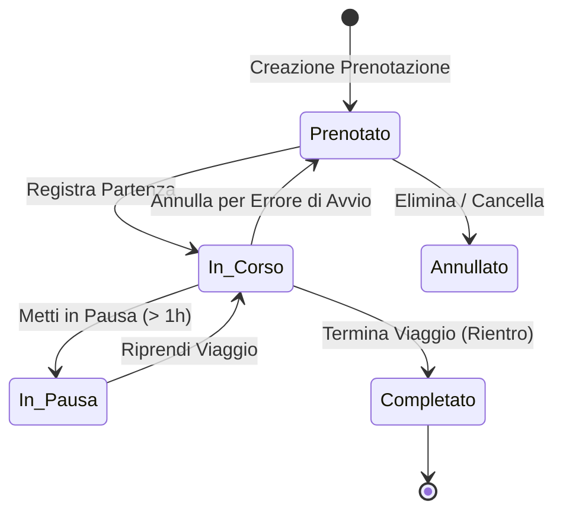

# Guida Completa alla Flotta Automezzi, Noleggi e Carpooling

Benvenuto nella documentazione unificata e guida operativa per la **Gestione della Flotta Aziendale e del Carpooling** in **Troubletick**. Questa guida descrive l'architettura tecnica, la matrice dei ruoli e dei permessi (RBAC), la gestione anagrafica degli autoveicoli e dei contratti di noleggio, il monitoraggio delle scadenze, i rifornimenti carburante, le manutenzioni programmate e straordinarie, nonché il ciclo di vita completo dei viaggi e delle prenotazioni.

---

## 🛠️ Architettura e Modalità di Erogazione

Il modulo Carpooling è progettato per garantire massima flessibilità sia in contesti aziendali integrati che su postazioni autonome dedicate:

* **Modalità Integrata (Predefinita)**: Il modulo fa parte dell'applicazione principale Troubletick (FastAPI / Uvicorn, accessibile da browser tramite porte `5000` o `5001`). Tutte le funzionalità sono distribuite nel menu superiore **Carpooling** e nelle sezioni di amministrazione.
* **Modalità Standalone (Opzionale)**: Per postazioni fisse, totem in portineria o reception dedicate al ritiro chiavi, il modulo Carpooling può essere avviato in modo indipendente tramite [app/appautopark.py](file:///g:/Il%20mio%20Drive/Progetti/ticketing/troubletick/app/appautopark.py) (eseguito su una porta dedicata, tipicamente `5002`, con `uvicorn appautopark:app --host 0.0.0.0 --port 5002`).
* **Database Condiviso**: Entrambe le modalità accedono al medesimo database SQLite locale (`troubletick.db`), assicurando la coerenza in tempo reale tra anagrafiche, utenti, ruoli, viaggi, manutenzioni e odometri.

---

## 👥 Matrice Ruoli e Permessi sulla Flotta

L'accesso alle funzionalità della flotta e del carpooling è regolato dalla matrice dei ruoli applicativa:

| Funzionalità | Utente (`normale`) | Operatore (`assistenza`) | Fleet Manager (`fleet_manager`) | Global Fleet Manager (`global_fleet_manager`) | Amministratore (`admin`) |
|---|:---:|:---:|:---:|:---:|:---:|
| **Prenotazione Autonoma** | ✅ | ✅ | ✅ | ✅ | ✅ |
| **Avvio / Pausa / Chiusura Viaggio** | ✅ (Propri) | ✅ (Propri) | ✅ (Propri / Terzi rep.) | ✅ (Tutti) | ✅ (Tutti) |
| **Prenotazione per Terzi** | ❌ | ❌ | ✅ (Solo colleghi reparto) | ✅ (Qualsiasi utente) | ✅ (Qualsiasi utente) |
| **Modifica Schede Automezzi** | ❌ | ❌ | ✅ (Solo proprio reparto) | ✅ (Tutti i veicoli) | ✅ (Tutti i veicoli) |
| **Inserimento Nuovi Automezzi** | ❌ | ❌ | ❌ *(Bloccato)* | ✅ | ✅ |
| **Scadenziario Noleggi** | ❌ | ❌ | ❌ *(Non visibile)* | ✅ | ✅ |
| **Esclusione dalla Prenotazione** | ❌ | ❌ | ✅ (Solo proprio reparto) | ✅ (Tutti i veicoli) | ✅ (Tutti i veicoli) |
| **Registro Viaggi & Rifornimenti** | ❌ | ❌ | ✅ (Solo proprio reparto) | ✅ (Tutta la flotta) | ✅ (Tutta la flotta) |
| **Gestione Manutenzioni & Tagliandi** | ❌ | ❌ | ❌ | ✅ | ✅ |
| **Configurazione Tipi Manutenzione** | ❌ | ❌ | ❌ | ✅ | ✅ |

### Dettaglio Ruoli
* **Amministratore (`admin`)**: Controllo totale e incondizionato su tutta la flotta, anagrafiche veicoli, dislocazioni, scadenziario noleggi, manutenzioni, rifornimenti, registri viaggi e configurazioni di sistema.
* **Global Fleet Manager (`global_fleet_manager`)**: Gestione operativa e strategica completa dell'intero parco auto aziendale senza vincoli di reparto. Ha i permessi esclusivi (insieme all'admin) per inserire nuovi veicoli, accedere allo Scadenziario Noleggi, gestire manutenzioni e registrare rifornimenti.
* **Fleet Manager di Reparto (`fleet_manager`)**: Responsabile del parco veicoli circoscritto al proprio reparto di appartenenza. Può consultare e aggiornare le schede dei mezzi assegnati al reparto, escluderli/riabilitarli alla prenotazione, prenotare per colleghi del proprio reparto, registrare rifornimenti e consultare i viaggi del reparto. **Non può** inserire nuovi automezzi (riservato ai Global FM), né accedere allo Scadenziario Noleggi o configurare i tipi manutenzione.
* **Operatore di Assistenza (`assistenza`)**: Prenotazione autonoma dei mezzi per interventi tecnici e trasferte di servizio, registrazione chilometri e modifica dei propri viaggi.
* **Utente Normale (`normale`)**: Consultazione disponibilità delle vetture nella propria sede, prenotazione viaggi, avvio, pausa e chiusura del rientro con rendicontazione chilometrica finale.

---

## 🚘 1. Anagrafica Automezzi, Noleggi e Gestione Flotta

### 1.1 Scheda Tecnico-Amministrativa dell'Automezzo
L'anagrafica centralizzata (`/admin/automezzi/dislocazioni`) raccoglie tutte le informazioni essenziali di ciascun mezzo:

* **Dati Identificativi**:
  - **Targa**: Identificativo univoco (salvato normalizzato in maiuscolo senza spazi o trattini per evitare duplicazioni accidentali).
  - **Marca**: Selezionata dall'anagrafica centralizzata marche (`/admin/automezzi/marche`).
  - **Modello**: Nome commerciale del veicolo.
  - **Tipologia**: *Auto* o *Furgone / Veicolo Commerciale*.
* **Caratteristiche Tecniche ed Ecologiche**:
  - **Alimentazione**: *Benzina*, *Diesel*, *GPL*, *Metano*, *Ibrida*, *Elettrica*.
  - **Classe Euro**: Normativa antinquinamento (es. *Euro 6d-Temp*, *Euro 5*).
  - **Note / Dotazioni**: Dettagli estetici o dotazioni speciali (es. *Gancio traino, portapacchi, catene da neve a bordo*).
* **Proprietà, Noleggio e Scadenze Contrattuali**:
  - **Proprietà**: *Proprietà aziendale* oppure *Noleggio a lungo termine*.
  - **Società di Noleggio / Fornitore**: Ragione sociale della società fornitrice (es. *LeasePlan*, *Arval*, *ALD Automotive*).
  - **Canone Noleggio (€)**: Costo mensile del noleggio per l'analisi economica.
  - **Data Inizio Noleggio**: Data di decorrenza del contratto di noleggio (`AAAA-MM-GG`).
  - **Durata Noleggio (Anni)**: Durata prevista in anni (es. 2, 3, 4, 5 anni).
  - **Data Scadenza Noleggio**: **Calcolata in automatico dal sistema** sommando la durata in anni alla data di inizio, con gestione precisa degli anni bisestili (il 29 febbraio su anni non bisestili scade regolarmente il 28 febbraio).
  - **Data Immatricolazione**: Data di prima immatricolazione del veicolo.
* **Stato e Chilometraggio**:
  - **Km Attuali**: Odometro aggiornato in tempo reale da chiusure viaggi, rifornimenti o interventi in officina.
  - **Stato Operativo**: *Disponibile*, *In Uso*, *In Manutenzione*.

---

### 1.2 Dislocazioni Sedi e Reparti Assegnati (`/admin/automezzi/dislocazioni`)
Consente di monitorare la presenza fisica delle vetture e la loro ripartizione aziendale:
* **Sede Assegnata**: Sede principale di pertinenza della vettura.
* **Sede Attuale**: Sede in cui il veicolo si trova fisicamente in questo istante (aggiornata in automatico se un viaggio termina in una sede diversa da quella di partenza).
* **Reparto Assegnato**: Reparto a cui è in carico il costo e la gestione del mezzo.

---

### 1.3 Gestione Marche e Tag Automezzi
* **Marche Automezzi (`/admin/automezzi/marche`)**: Anagrafica centralizzata delle case costruttrici disponibili per la flotta.
* **Tag Automezzi (`/admin/automezzi/tag`)**: Etichette personalizzabili (es. *Pool Aziendale*, *Direzione*, *Sostitutiva*, *Dotazione Invernale*) assegnabili ai mezzi per facilitare la ricerca e il filtraggio.

---

### 1.4 Esclusione dalla Prenotazione (Fermo Tecnico Riservato)
La funzionalità **Escludi da Prenotazione** (`escluso_prenotazione = 1`) rimuove temporaneamente un automezzo dal tabellone di prenotazione pubblica:
* **Casi d'Uso**: Mezzo riservato in uso esclusivo, fermo per guasto prolungato, veicolo in attesa di sostituzione o alienazione.
* **Regole RBAC**: I Fleet Manager di reparto possono escludere/riabilitare solo i mezzi del proprio reparto; i Global Fleet Manager e gli Amministratori possono intervenire su qualsiasi veicolo aziendale.

---

### 1.5 Scadenziario Noleggi Autoveicoli (`/admin/automezzi/noleggi`)
Cruscotto di controllo ad alta visibilità dedicato alla gestione dei contratti di locazione e noleggio a lungo termine:
* **Accesso Riservato**: Visibile ed accessibile esclusivamente ad **`admin`** e **`global_fleet_manager`**.
* **Contatori KPI in Tempo Reale**:
  - *Totale Noleggi*: Tutti i veicoli a noleggio censiti nella flotta.
  - *Scaduti*: Contratti la cui data di scadenza è antecedente a quella odierna.
  - *In Scadenza (≤ 90 gg)*: Contratti che scadranno entro i prossimi 3 mesi, con contatore dei giorni mancanti.
  - *Regolari (> 90 gg)*: Contratti con validità residua superiore a 90 giorni.
* **Badge Visivi**:
  - 🔴 **Scaduto**: Giorni trascorsi dalla scadenza contrattuale (`-X gg`).
  - 🟡 **In Scadenza**: Giorni rimanenti alla scadenza (`X gg`).
  - 🟢 **Regolare**: Contratto attivo con scadenza a lungo termine.
  - ⚪ **Non Definito**: Mezzo a noleggio privo di data di inizio o durata.
* **Strumenti e Reportistica**:
  - Filtri per stato scadenza, fornitore di noleggio e ricerca per targa/modello.
  - Ordinamento immediato per data scadenza (più urgenti in cima).
  - Modifica rapida dei parametri contrattuali via modale interattivo.
  - Esportazione dedicata in CSV (`/admin/automezzi/noleggi/esporta/csv`).

---

## ⛽ 2. Gestione Rifornimenti Carburante

Il modulo Rifornimenti (`/admin/automezzi/rifornimenti`) monitora i costi energetici e l'utilizzo delle carte carburante:

* **Parametri Rilevati**: Targa, data e ora, chilometraggio all'erogazione, numero PAN della carta carburante, prodotto (*Gasolio, Benzina SP, GPL, Metano, Ricarica Elettrica*), litri/kWh erogati, prezzo unitario al litro, importo totale lordo, importo imponibile, IVA, sconto applicato, codice impianto e stazione di servizio.
* **Aggiornamento Automatico Odometro**: Se i chilometri inseriti nel rifornimento sono superiori al chilometraggio registrato per il veicolo, il sistema aggiorna automaticamente i `km_attuali` dell'auto e traccia l'evento nel registro storico dei chilometri (`registro_km_automezzi`).
* **Importazione ed Esportazione CSV**: Possibilità di importare periodicamente i file tracciati forniti dalle compagnie petrolifere ed esportare i report di riepilogo per il calcolo dei consumi medi (L/100 km).

---

## 🔧 3. Gestione Manutenzioni e Tagliandi

Il modulo Manutenzioni (`/admin/automezzi/manutenzioni`) presidia l'efficienza meccanica e la sicurezza dei mezzi:

* **Tipi di Manutenzione (`/admin/automezzi/tipi-manutenzione`)**: Configurazione delle categorie di intervento (es. *Tagliando*, *Cambio Gomme*, *Revisione MCTC*, *Freni*, *Carrozzeria*) con cadenze temporali (in mesi/anni) e/o chilometriche.
* **Stati della Manutenzione**:
  1. **Programmata**: Intervento pianificato per una data futura; l'auto resta prenotabile fino all'inizio dei lavori.
  2. **In Corso (Bloccante)**: Al ricovero dell'auto in officina, lo stato passa a *In Manutenzione*. Eventuali prenotazioni in sovrapposizione vengono inibite.
  3. **Conclusa**: Al ritiro dell'auto, si registrano data/ora fine, km finali, costo complessivo (€), officina e note tecniche. L'auto torna *Disponibile*.
  4. **Annullata**: Cancellazione dell'intervento con ripristino della disponibilità.

---

## 📅 4. Gestione Carpooling, Prenotazioni e Ciclo di Vita del Viaggio

### 4.1 Modalità di Prenotazione (`/autopark`)
* **Prenotazione Standard (Pianificata)**:
  - L'utente seleziona sede di partenza, data/ora inizio e data/ora fine prevista.
  - Il sistema propone solo le vetture disponibili in quella sede che non abbiano sovrapposizioni orarie né fermi tecnici.
  - Vengono bloccate prenotazioni sovrapposte sullo stesso veicolo o per lo stesso conducente.
* **Prenotazione Istantanea (Partenza Immediata)**:
  - Consente all'utente di partire subito senza preavviso. Il sistema imposta la data odierna e l'orario corrente, permettendo la selezione dei veicoli liberi in loco.
* **Prenotazione per Terzi**:
  - I Fleet Manager possono effettuare prenotazioni indicando l'email di un collega del proprio reparto.
  - Global Fleet Manager e Admin possono prenotare a nome di qualsiasi dipendente aziendale.

---

### 4.2 Gestione Operativa del Viaggio

1. **Avvio Viaggio (Partenza / Check-in)**:
   - Cliccando su **Registra Viaggio**, il sistema archivia l'orario effettivo di partenza e propone i `km_iniziali` sincronizzati con l'auto.
   - Lo stato dell'automezzo passa a **In Uso** e il viaggio diventa **In Corso**.
2. **Pausa e Ripresa del Viaggio**:
   - Durante soste prolungate (consigliato per soste superiori a 1 ora), il conducente può contrassegnare il viaggio come **In Pausa**.
   - Il sistema conteggia e accumula automaticamente i minuti totali di sosta, rendendoli visibili nel registro storico.
   - Cliccando su **Riprendi**, il viaggio torna regolarmente *In Corso*.
3. **Annulla Viaggio (Errore di Avvio)**:
   - Se l'utente ha avviato il viaggio per errore, può cliccare su **Annulla**.
   - Il sistema resetta l'orario effettivo di partenza e le pause, ripristinando il viaggio allo stato di semplice prenotazione futura.
4. **Termine Viaggio (Chiusura & Rientro)**:
   - Al rientro, il conducente clicca su **Termina** e compila il modulo obbligatorio:
     - **Ora di Rientro**: Deve essere posteriore all'orario di partenza.
     - **KM Finali**: Devono essere superiori o uguali ai chilometri di partenza. Il sistema aggiorna l'odometro del veicolo e registra la percorrenza netta.
     - **Sede di Rientro**: Se il veicolo viene parcheggiato in una sede diversa da quella di partenza, la `sede_attuale_id` della vettura viene aggiornata automaticamente.
     - **Controllo Data**: Se il rientro avviene in un giorno successivo, il sistema mostra un avviso ma registra l'avvenuta riconsegna.
   - Lo stato dell'automezzo viene riallineato a **Disponibile**.
5. **Modifica Postuma Viaggi (Self-Service & Admin)**:
   - Dipendenti e operatori possono rettificare orari, chilometri finali e note dei propri viaggi completati. Amministratori e Fleet Manager possono intervenire su qualsiasi viaggio di competenza.

---

## 🗄️ 5. Tabella di Corrispondenza Stati e Database

### Stati del Veicolo (`automezzi.stato`)
| Stato | Descrizione | Regole di Prenotazione |
|---|---|---|
| **Disponibile** | Veicolo parcheggiato e pronto all'uso presso la sede attuale | Selezionabile per nuovi viaggi |
| **In Uso** | Veicolo attualmente in viaggio con un conducente | Inibito per viaggi sovrapposti |
| **In Manutenzione** | Veicolo ricoverato in officina per intervento bloccante | Completamente bloccato |

### Stati del Viaggio (`viaggi_automezzi`)
| Stato Viaggio | Condizioni nel Database | Descrizione Visiva |
|---|---|---|
| **Prenotato** | `ora_partenza_effettiva IS NULL`, `ora_arrivo IS NULL`, data &ge; oggi | Riservato in calendario, viaggio non ancora avviato |
| **In Corso** | `ora_partenza_effettiva IS NOT NULL`, `ora_arrivo IS NULL`, `in_pausa = 0` | Conducente alla guida del mezzo |
| **In Pausa** | `ora_partenza_effettiva IS NOT NULL`, `ora_arrivo IS NULL`, `in_pausa = 1` | Viaggio iniziato ma momentaneamente fermo |
| **Completato**| `ora_arrivo IS NOT NULL` | Mezzo riconsegnato, km finali registrati |

---

## 📊 6. Monitoraggio Costi, KPI e TCO (Total Cost of Ownership)

Nella dashboard di amministrazione della flotta (`/admin/automezzi/gestione` e `/admin/automezzi/dislocazioni`), i responsabili possono analizzare gli indicatori globali:
* **Costi Canoni Noleggio**: Spesa mensile e annua per canoni di locazione a lungo termine.
* **Costi Carburante**: Spesa cumulativa derivante dai tracciati delle carte carburante.
* **Costi Manutenzione**: Totale spese per tagliandi ordinari, pneumatici e riparazioni d'officina.
* **Costo Medio al Chilometro (€/km)**: Incrocio tra spese complessive e chilometri totali percorsi dalla flotta per orientare le scelte di rinnovo del parco auto.

---

## ❓ 7. Risoluzione dei Problemi Comuni (FAQ)

1. **Un veicolo non compare tra quelli selezionabili per una prenotazione**:
   - Verificare che il veicolo sia contrassegnato come *Disponibile* e non *In Manutenzione*.
   - Verificare che la sede di partenza della prenotazione coincida con la *Sede Attuale* del mezzo.
   - Controllare che il veicolo non sia stato *Escluso dalla prenotazione* da un Fleet Manager.
   - Verificare che non vi siano altre prenotazioni già registrate nella stessa fascia oraria.

2. **Un Fleet Manager non visualizza il pulsante "+ Nuovo Veicolo"**:
   - L'inserimento di nuovi automezzi è riservato a **`admin`** e **`global_fleet_manager`**. I Fleet Manager di reparto possono solo modificare e gestire i mezzi assegnati al loro reparto.

3. **La data di scadenza del noleggio non è valorizzata**:
   - Accertarsi che il campo *Proprietà* sia impostato su *Noleggio* e che siano stati inseriti sia la *Data Inizio Noleggio* che la *Durata (Anni)*. Il sistema calcolerà la scadenza all'atto del salvataggio.
