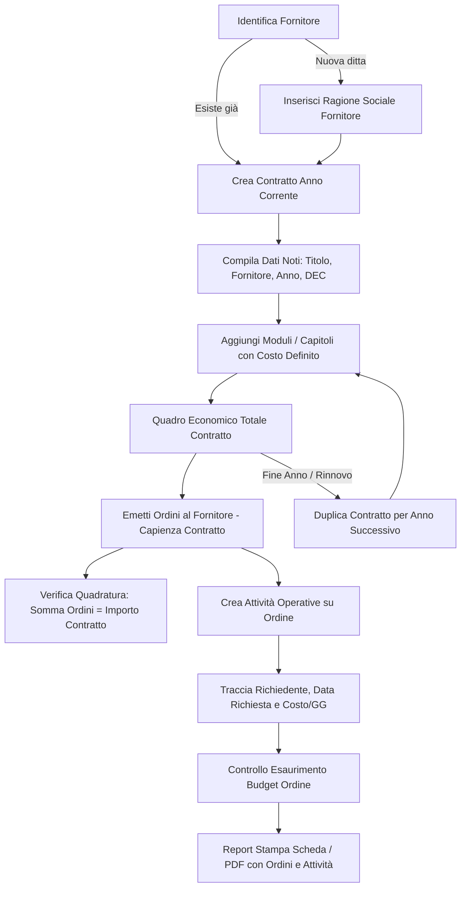

# Guida alla Gestione dei Contratti di Fornitura Servizi

Questa guida descrive il funzionamento, la struttura e le migliori pratiche operative per la gestione dei **Contratti di Fornitura e Manutenzione Annuali dei Servizi** all'interno dell'applicazione.

---

## 1. Panoramica del Modulo

Il modulo **Contratti** permette di censire e monitorare i contratti di manutenzione e fornitura dei servizi, tracciare i relativi costi, associare i fornitori e identificare il **DEC** (*Direttore dell'Esecuzione del Contratto*).

### Chi ha accesso al modulo:
* **Amministratori**: visualizzano e gestiscono tutti i contratti, gli ordini al fornitore, le attività operative e le anagrafiche dei fornitori.
* **Responsabili di Reparto**: visualizzano e gestiscono i contratti, gli ordini e le attività operative associati al proprio reparto o gestiti da operatori appartenenti al reparto stesso.
* **Operatori con tag DEC**: gli operatori che hanno il tag `DEC` nel proprio profilo possono visualizzare e gestire i contratti di cui sono referenti o creatori (inclusa l'emissione degli ordini e la rendicontazione delle relative attività operative), e dispongono della **gestione completa dei fornitori** (creazione, modifica, schede di contatto escalation e associazione ai servizi).
* **Utenti con tag Amministrazione**: dispongono della **gestione completa dei fornitori** (creazione, modifica anagrafica, schede di contatto escalation e associazione ai servizi).

---

## 2. Suggerimenti e Best Practice Operative

Per garantire una gestione snella, ordinata ed efficace dei contratti, si raccomanda di seguire queste linee guida:

### A. Inserire l'Anno in Corso e Usare la Funzione "Copia" per gli Anni Successivi
> [!TIP]
> **Consiglio Operativo**: Inserisci inizialmente i contratti relativi all'**anno in corso**, valorizzando i relativi capitoli di spesa (moduli).
>
> Quando dovrai predisporre i contratti per l'anno venturo, non occorre reinserire tutto da zero: utilizza il pulsante **"Copia per l'Anno Successivo"** (`Duplica Contratto`) presente nella scheda di dettaglio o nell'elenco. Il sistema clonerà automaticamente il contratto e **tutti i suoi moduli di fornitura**, aggiornando l'anno e il titolo. Potrai poi apportare solo i piccoli ritocchi necessari (es. eventuali variazioni tariffarie o di CIG/CUP).

### B. Compilare solo i Campi Conosciuti
> [!NOTE]
> Non è necessario reperire subito tutti i dati amministrativi per inserire un contratto.
>
> Compila **esclusivamente i campi noti** al momento dell'inserimento (ad esempio: *Titolo*, *Fornitore*, *Anno*). I codici formali come **CIG**, **CUP**, **Numero Contratto** o note integrative possono essere lasciati vuoti e compilati o aggiornati in qualsiasi momento successivo.

### C. Cosa sono i Moduli: Capitoli del Capitolato con Costo Definito (IVA Esclusa)
> [!IMPORTANT]
> I **Moduli di Fornitura** rappresentano i singoli **capitoli o servizi del capitolato di gara/fornitura che hanno un costo economico definito**.
> 
> * **Importi IVA Esclusa**: Tutti gli importi economici registrati (costo totale della voce, costo giornaliero/orario e totale del contratto) si intendono **al netto di IVA (IVA esclusa)**.
> * **Cosa inserire come modulo**: Servizi a canone fisso/forfettario (es. *"Canone manutenzione licenze software annuali - € 4.500,00 + IVA"*) oppure prestazioni a consumo/giornate (es. *"Supporto specialistico sistemistico - 20 giornate a 350,00 €/giorno + IVA"*).
> * **Cosa evitare**: **Evitare di inserire moduli puramente descrittivi a costo zero (€ 0,00)**. Se un capitolo del capitolato contiene clausole di servizio o descrizioni tecniche senza un importo economico autonomo, inserisci tali note nel campo descrittivo generale del contratto anziché creare un modulo vuoto. I moduli servono a comporre e valorizzare il **quadro economico complessivo**.

### D. Anagrafica Fornitori: Inserimento Rapido con Ragione Sociale
> [!TIP]
> Per inserire un nuovo fornitore non serve reperire subito l'intera scheda camerale.
>
> È sufficiente indicare anche **soltanto la Ragione Sociale** della ditta fornitrice. Tutti gli altri dettagli (Partita IVA, Codice Fiscale, PEC, email per gli ordini, numeri telefonici, referente commerciale/tecnico e indirizzo) possono essere aggiunti in seguito dall'anagrafica fornitori.

### E. Ordini al Fornitore e Allineamento Economico
> [!IMPORTANT]
> **Relazione tra Moduli e Ordini**: I moduli del capitolato definiscono il valore complessivo e la natura economica dell'accordo. Gli **Ordini al Fornitore** rappresentano gli atti di impegno esecutivo verso il fornitore.
>
> * **Quadratura consigliata al 100%**: È fortemente raccomandato che la somma degli importi degli ordini emessi coincida con l'importo totale del contratto. In questo modo l'intero plafond contrattuale risulta formalizzato e controllabile.
> * **Vincolo di non superamento**: Il sistema impedisce qualsiasi emissione di ordini che ecceda il budget contrattuale.

### F. Rendicontazione delle Attività e Tracciabilità delle Richieste
> [!TIP]
> **Tracciamento Chi / Quando**: Per ogni attività è fondamentale registrare **chi ha richiesto l'intervento** (es. Responsabile, Coordinatore o Ufficio) e **quando è stata effettuata la richiesta**. Questo consente al DEC e all'Amministrazione una tracciabilità trasparente in fase di liquidazione delle fatture.
>
> * **Fino ad esaurimento**: Le attività consumano progressivamente la capienza dell'ordine (sia in termini di importo in Euro sia in giornate/uomo). Quando l'ordine è esaurito al 100%, il sistema blocca ulteriori inserimenti.

---

## 3. Flusso di Lavoro Operativo

### Passo 1: Creazione o Selezione del Fornitore
* Accedi a **Contratti** &rarr; **Nuovo Contratto** (o da **Fornitori** &rarr; **Nuovo Fornitore**).
* Seleziona il fornitore dal menu a tendina o creane uno al volo indicando almeno la Ragione Sociale.

### Passo 2: Dati Generali del Contratto
* Inserisci il **Titolo del contratto** (es. *"Manutenzione Sistemi e Infrastruttura di Rete 2026"*).
* Seleziona l'**Anno di competenza** (es. *2026*).
* Indica lo **Stato iniziale** (*Attivo*, *In trattativa*, *In definizione*, *Scaduto*, *Concluso*).
* Seleziona il **DEC** incaricato della supervisione e il **Reparto** di appartenenza.
* Inserisci eventuali codici noti (**CIG**, **CUP**, **Numero Documento**).

### Passo 3: Inserimento Moduli di Spesa / Capitoli del Capitolato
Dalla scheda di dettaglio del contratto:
1. Clicca su **"Aggiungi Modulo"**.
2. Specifica la **Descrizione del capitolo di fornitura** (es. *"Assistenza On-Site su Chiamata"*).
3. Opzionalmente collega una tipologia di servizio a catalogo.
4. Definisci l'importo economico (**IVA esclusa**):
   * **A tariffa oraria/giornaliera**: inserisci il numero di giornate stimate e il costo unitario giornaliero (il totale viene calcolato automaticamente).
   * **A canone fisso forfettario**: inserisci direttamente il costo totale della voce.

### Passo 4: Ordini al Fornitore e Regola di Quadratura Economica
Dalla scheda di dettaglio del contratto è possibile associare **Ordini al Fornitore**:
1. Clicca su **"Nuovo Ordine"**.
2. Specifica il **Codice Ordine** (es. `ORD-2026/01`), il **CIG specifico**, la **Descrizione/Oggetto** e la **Durata** stimata (es. `12 mesi`).
3. Definisci l'**Importo economico** dell'ordine (IVA esclusa), direttamente oppure calcolato moltiplicando **Giornate previste** $\times$ **Costo giornaliero**.
4. **Regola Economica Vincolante**:
   > [!IMPORTANT]
   > **Tetto di Spesa**: La sommatoria degli importi degli ordini di un contratto **non può superare l'importo del contratto**.
   > Se si tenta di inserire un ordine con importo eccedente la capienza residua, il sistema blocca l'operazione.
   > 
   > **Consiglio di quadratura**: È **consigliabile che la somma degli ordini corrisponda esattamente al 100% dell'importo del contratto**. Se residua un importo non ancora ordinato, il sistema mostra un avviso informativo che evidenzia la quota ancora disponibile.

---

### Passo 5: Creazione delle Attività Operative dell'Ordine (Fino ad Esaurimento)
Dalla scheda del singolo ordine (cliccando su *"Apri Scheda"* o sul codice ordine):
1. Clicca su **"Nuova Attività"**.
2. Specifica la **Descrizione dell'intervento** o della prestazione svolta.
3. Compila il tracciamento della richiesta:
   * **Chi ha chiesto l'attività**: nominativo o ufficio del richiedente (es. *"Ing. Mario Rossi - Ufficio Tecnico"*).
   * **Quando è stata chiesta**: data in cui è stata formalizzata o pervenuta la richiesta.
   * **Note aggiuntive**: eventuali note descrittive, ticket correlati, SLA o modalità di esecuzione.
4. Indica la **Data di Inizio** ed eventualmente la **Data di Fine**.
5. Seleziona lo **Stato** (*Pianificata*, *In corso*, *Completata*, *Sospesa*, *Annullata*).
6. Assegna il valore economico:
   * **A costo diretto**: indica l'importo consuntivato/impegnato dall'attività.
   * **A giornate**: se l'ordine prevede una tariffa giornaliera, indicando il numero di giornate il costo viene calcolato automaticamente.
7. **Regola di Esaurimento**:
   > [!IMPORTANT]
   > Le attività possono essere create ed eseguite **fino ad esaurimento dell'importo dell'ordine**.
   > Il sistema calcola in tempo reale la capienza residua e blocca inserimenti che eccedono il budget o le giornate dell'ordine.

---

### Passo 6: Monitoraggio, Filtri ed Esportazione CSV
Dall'elenco contratti e dal riepilogo economico è possibile:
* Filtrare i contratti per **Anno**, **Stato**, **Fornitore**, **Operatore DEC** e **Reparto**.
* **Ordinare la tabella** cliccando sull'intestazione di qualsiasi colonna (*Anno*, *Titolo*, *Fornitore*, *DEC / Reparto*, *Moduli*, *Importo*, *Stato*) in ordine crescente o decrescente con anteprima immediata.
* Effettuare ricerche testuali rapide per titolo, codice contratto, CIG, CUP, fornitore e operatore DEC.
* **Esportare in CSV** (`.csv`) l'elenco visibile filtrato per elaborazioni in Microsoft Excel, con encoding UTF-8 compatibile, separatore punto e virgola (`;`), importi economici e dettagli completi (fornitore, DEC, date, totali moduli e giornate).
* Visualizzare il **Riepilogo Economico** con totali spesa, percentuali per fornitore e reparto.

---

### Passo 7: Stampa del Contratto con Ordini e Attività
Cliccando su **"Stampa Scheda"** si ottiene una versione pulita, priva di elementi di navigazione, ideale per:
* Archiviazione cartacea o salvataggio in PDF.
* Report per il DEC, la Direzione o gli uffici amministrativi con il dettaglio sia dei moduli del capitolato sia di tutti gli **Ordini emessi e Attività operative eseguite**, con quadro di quadratura economica.
* Raccolta firme formali tra DEC e Referente del Fornitore.

---

### Passo 8: Rinnovo per l'Anno Successivo (Duplicazione)
Quando si apre la nuova annualità:
1. Apri la scheda del contratto dell'anno precedente.
2. Clicca su **"Copia per Anno Successivo"** (icona con due fogli sovrapposti).
3. Conferma il nuovo anno di destinazione (proposto in automatico come anno successivo).
4. Il sistema clonerà il contratto e tutti i suoi capitoli/moduli di fornitura, pronti per essere utilizzati o adeguati.

---

## 4. Stati del Contratto, degli Ordini e delle Attività

### Stati del Contratto
| Stato | Badge | Significato |
|---|:---:|---|
| **In Trattativa** | Arancione | Contratto in fase di negoziazione preliminare o commerciale con il fornitore. |
| **In Definizione** | Giallo | Contratto in fase di predisposizione o redazione formale, non ancora esecutivo. |
| **Attivo** | Verde | Contratto in corso di validità ed esecuzione per l'annualità di riferimento. |
| **Scaduto** | Rosso | Annualità contrattuale terminata; è possibile rinnovare o archiviare. |
| **Concluso** | Grigio | Fornitura completata e chiusa regolarmente. |

### Stati dell'Ordine al Fornitore
| Stato | Badge | Significato |
|---|:---:|---|
| **Emesso** | Blu | Ordine formalizzato e trasmesso al fornitore. |
| **In Corso** | Azzurro | Ordine in fase di svolgimento con attività aperte. |
| **Completato** | Verde | Fornitura dell'ordine ultimata con esaurimento o saldo delle prestazioni. |
| **Annullato** | Grigio | Ordine revocato (non impegna capienza sul contratto). |

### Stati delle Attività Operative
| Stato | Badge | Significato |
|---|:---:|---|
| **Pianificata** | Giallo | Attività programmata o richiesta, in attesa di avvio. |
| **In Corso** | Blu | Attività in fase di esecuzione o lavorazione tecnica. |
| **Completata** | Verde | Attività conclusa con successo e consuntivata. |
| **Sospesa** | Arancione | Attività temporaneamente bloccata in attesa di sblocco/parti. |
| **Annullata** | Grigio | Attività annullata (il budget viene riaccreditato all'ordine). |

---

## 5. Esempi Pratici di Quadratura ed Esaurimento

### Scenario A: Quadratura Economica del Contratto
Immaginiamo un contratto di manutenzione annuale con quadro economico di **€ 15.000,00** (IVA esclusa), composto da due moduli:
* **Modulo 1**: Canone licenze e manutenzione base &rarr; **€ 9.000,00**
* **Modulo 2**: Supporto specialistico sistemistico a consumo &rarr; 20 giornate a 300,00 €/gg = **€ 6.000,00**

**Emissione degli Ordini al Fornitore:**
1. Viene emesso l'**Ordine 1** per il canone con importo pari a **€ 9.000,00**.
   * *Stato Quadro Economico*: Somma ordini = € 9.000,00 (60%).
   * *Segnalazione Sistema*: Badge giallo *"Residuo da ordinare: € 6.000,00 - Consigliabile coprire l'intero importo contrattuale"*.
2. Viene emesso l'**Ordine 2** per il supporto specialistico con 20 giornate a 300,00 €/gg = **€ 6.000,00**.
   * *Stato Quadro Economico*: Somma ordini = € 15.000,00 (100%).
   * *Segnalazione Sistema*: Badge verde *"Copertura 100% - La sommatoria degli ordini corrisponde esattamente all'importo del contratto"*.
3. Se un operatore tentasse di inserire un ulteriore ordine da € 500,00, il sistema **bloccherà l'inserimento** con avviso esplicito di superamento capienza.

### Scenario B: Tracciamento delle Attività ed Esaurimento dell'Ordine
Prendiamo l'**Ordine 2** (Plafond: **€ 6.000,00**, 20 giornate a 300,00 €/gg).
Durante l'anno il DEC e i referenti registrano gli interventi eseguiti:

1. **Attività 1**: *"Risoluzione incidente cluster database di produzione"*
   * **Chi ha chiesto**: *Ing. Mario Bianchi (Referente Sistemi)*
   * **Quando è stata chiesta**: *10/02/2026*
   * **Valore**: 2 giornate &rarr; Costo calcolato = **€ 600,00**
   * *Residuo Ordine*: € 5.400,00 (18,0 giornate residue) &bull; Consumato: 10%.

2. **Attività 2**: *"Aggiornamento firmware apparati di rete e bonifica VLAN"*
   * **Chi ha chiesto**: *Ufficio Reti e Telecomunicazioni*
   * **Quando è stata chiesta**: *05/03/2026*
   * **Valore**: 4 giornate &rarr; Costo calcolato = **€ 1.200,00**
   * *Residuo Ordine*: € 4.200,00 (14,0 giornate residue) &bull; Consumato: 30%.

3. **Monitoraggio e Blocco Esaurimento**:
   * La barra di avanzamento della scheda ordine indica in tempo reale il montante consumato.
   * Se il fornitore presenta un intervento finale che richiederebbe 16 giornate (€ 4.800,00), il sistema rifiuta l'inserimento poiché eccede le 14 giornate (€ 4.200,00) residue, proteggendo l'ente o l'azienda da sforamenti di budget non autorizzati.

